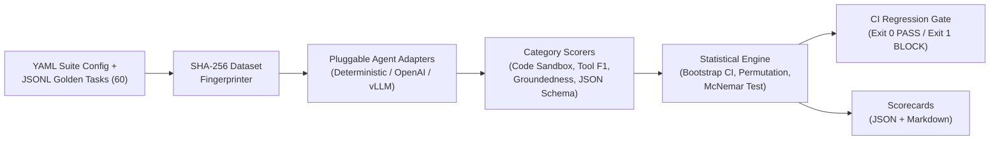

# llm-agent-eval-harness

[](https://github.com/zzzzzzzzak/llm-agent-eval-harness/actions/workflows/ci.yml)
[](https://www.python.org/)
[](tests/)
[](datasets/agent_eval_suite.jsonl)

A deterministic, CLI-driven evaluation and CI regression-gating framework for frontier LLMs and enterprise AI agents. Evaluates code synthesis, multi-step tool trajectories, contextual groundedness, and strict JSON outputs with statistical hypothesis testing and cryptographic dataset fingerprinting.

---

## Why This Exists

Ad-hoc prompt spot-checking hides regressions behind sampling variance. Shipping model updates, prompt revisions, or quantization changes requires:
1. **Objective programmatic scorers** (subprocess-isolated code execution, trajectory DAG checks, numerical hallucination detection, strict schema validation).
2. **Statistical rigor** (95% bootstrap confidence intervals, paired permutation tests, exact/Yates McNemar tests) so small deltas are separated from noise.
3. **Automated CI gating** (standard Unix exit codes `0` / `1` blocking releases when quality regresses or p95 latency breaches SLA).

---

## Architecture



---

## Measured Evaluation Results (`candidate_v2` vs. `baseline_v1`)

Executed deterministically across the 60-task suite (`SHA-256: fda65077f0588ca4`). Full report saved in [`reports/eval_scorecard.md`](reports/eval_scorecard.md) and [`reports/eval_comparison_report.json`](reports/eval_comparison_report.json).

### Headline Comparison (95% Bootstrap CI)

| Metric | `baseline_v1` | `candidate_v2` | Delta | Statistical Test |
|---|:---:|:---:|:---:|:---|
| **Mean Score** | 0.8668 `[0.788, 0.936]` | **0.9728** `[0.939, 1.000]` | **+0.1060** | Paired Permutation `p = 0.00260` |
| **Pass Rate** | 80.0% | **95.0%** | **+15.0%** | McNemar Exact `p = 0.00391` (`win=9, loss=0`) |
| **p95 Latency** | 680.5 ms | **578.2 ms** | -102.3 ms | Passes `< 1200 ms` SLA |
| **Gate Decision** | — | **`PASS`** | — | Exit Code `0` |

### Category Breakdown (15 Tasks Each)

| Category | Evaluation Method | `baseline_v1` | `candidate_v2` | Delta |
|---|---|:---:|:---:|:---:|
| `code_synthesis` | Subprocess-isolated Python execution + hidden unit assertions + wall-clock timeout | 0.8667 | **1.0000** | +0.1333 |
| `tool_trajectory` | Multiset tool-selection F1 + argument exactness + causal ordering score | 0.9156 | **0.9578** | +0.0422 |
| `grounded_qa` | Required fact recall + strict numerical grounding against context (flags invented numbers) | 0.8183 | **0.9333** | +0.1150 |
| `structured_json` | Strict JSON parsing + Python type-contract enforcement (`bool`-vs-`int` guarded) | 0.8667 | **1.0000** | +0.1333 |

---

## Core Components

- **Unbiased Pass@k (`src/scorers.py`)**: Exact combinatorial estimator $1 - \binom{n-c}{k}/\binom{n}{k}$ via `math.comb`.
- **Sandboxed Code Execution (`src/scorers.py`)**: Runs generated solutions in isolated Python subprocesses with hard timeout enforcement to prevent infinite loops from hanging CI.
- **Statistical Engine (`src/statistics.py`)**:
  - Deterministic percentile **Bootstrap 95% CI** (`2,000` resamples).
  - Non-parametric **Paired Permutation Test** (`5,000` sign-flips) over task-level score deltas.
  - **McNemar's Test** switching automatically between exact two-sided binomial (`discordant < 25`) and Yates continuity-corrected $\chi^2$ (`discordant >= 25`).
- **Live & Offline Adapters (`src/adapters.py`)**:
  - `DeterministicBenchmarkAdapter`: Reproducible `baseline_v1`, `candidate_v2`, and `candidate_v2_regressed` profiles for zero-API-key testing and CI.
  - `OpenAICompatibleAdapter`: Zero-dependency HTTP client supporting OpenAI, self-hosted `vLLM`, and local `Ollama` endpoints via `OPENAI_BASE_URL` and `OPENAI_API_KEY`.

---

## Repository Structure

```text
llm-agent-eval-harness/
├── .github/workflows/ci.yml           # Automated pytest + 60-task regression gate
├── configs/
│   └── eval_suite.yaml                # Dataset path, timeout & regression gate SLA rules
├── datasets/
│   └── agent_eval_suite.jsonl         # 60 golden tasks across 4 evaluation tracks
├── reports/
│   ├── eval_comparison_report.json    # Machine-readable evaluation & statistical output
│   └── eval_scorecard.md              # Executive Markdown comparison scorecard
├── src/
│   ├── schemas.py                     # Typed task/trace contracts & SHA-256 fingerprinting
│   ├── scorers.py                     # Pass@k, code sandbox, tool F1, groundedness, JSON
│   ├── statistics.py                  # Bootstrap CI, paired permutation, McNemar, p50/p95/p99
│   ├── adapters.py                    # Deterministic benchmark + live OpenAI/vLLM adapters
│   └── harness.py                     # Runner, statistical comparator & gatekeeper
├── tests/
│   ├── test_scorers.py                # Combinatorial Pass@k, timeout, hallucination & schema tests
│   ├── test_statistics.py             # Bootstrap determinism, permutation & McNemar math tests
│   └── test_harness_and_gating.py     # End-to-end 60-task gate PASS & BLOCK verification
├── eval_cli.py                        # Programmatic CLI entrypoint (exit 0 / exit 1)
├── requirements.txt
└── README.md
```

---

## Quickstart & CLI Usage

```bash
git clone https://github.com/zzzzzzzzak/llm-agent-eval-harness.git
cd llm-agent-eval-harness

pip install -r requirements.txt

# 1. Run unit, statistical & gating verification suite
pytest tests/ -v

# 2. Run passing release evaluation (Exit Code 0)
python eval_cli.py --config configs/eval_suite.yaml --baseline baseline_v1 --candidate candidate_v2

# 3. Demonstrate CI regression blocking on a degraded model (Exit Code 1)
python eval_cli.py --config configs/eval_suite.yaml --baseline baseline_v1 --candidate candidate_v2_regressed

# 4. Evaluate a live OpenAI / vLLM / Ollama endpoint
OPENAI_BASE_URL="http://localhost:8000/v1" OPENAI_API_KEY="token" \
python eval_cli.py --baseline baseline_v1 --candidate openai:meta-llama/Llama-3.1-8B-Instruct
```

---

## Author

**Siddiqui Zakir Ali**  
*ML Systems & Data Analytics | Evaluation Harnesses, Numerical Computing & Production Pipelines*  
* [LinkedIn](https://linkedin.com/in/zakir-siddiqui-182b9711a)
* [GitHub](https://github.com/zzzzzzzzak)
